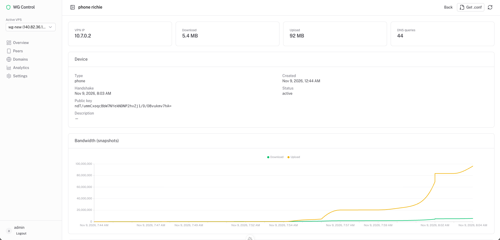

<div align="center">

# wgcontrol

### wireguard-control

**Localhost WireGuard multi-VPS management and monitoring dashboard.**

Manage peers, DNS activity, and traffic across remote VPS hosts — without exposing the control plane.

<br/>

[](./package.json)
[](https://nuxt.com)
[](https://nodejs.org)
[](https://github.com/adislksn/wireguard-control/actions)
[](./LICENSE)

<br/>

[Features](#features) ·
[Quick start](#quick-start) ·
[How it works](#how-it-works) ·
[Usage](#usage) ·
[Scripts](#scripts) ·
[Documentation](#documentation) ·
[License](#license)

<br/>

```bash
cp .env.example .env && npm install && npm run dev
```

</div>

> [!IMPORTANT]
> **wgcontrol** binds to `127.0.0.1` by default. Change the bootstrap admin password immediately (`WGCONTROL_ADMIN_PASSWORD`). Never commit `.env`, SQLite databases, or SSH private keys under `~/.wgcontrol/keys/`.

<br/>

<div align="center">



</div>

## Features

- Multi-VPS profiles with SSH key bootstrap and active host switching
- Nyr-compatible WireGuard init / clean purge on remote hosts
- Peer add / revoke with live `wg set`, QR + `.conf` download
- Lightweight VPS collectors (`wg show dump`, dnsmasq query logs)
- Local Drizzle + SQLite analytics and retention
- Localhost bind + session authentication

## Quick start

```bash
cp .env.example .env
npm install
npm run dev
```

Open [http://127.0.0.1:3000](http://127.0.0.1:3000) and sign in:

| | Default | Env override |
|---|---|---|
| User | `admin` | `WGCONTROL_ADMIN_USER` |
| Password | `changeme` | `WGCONTROL_ADMIN_PASSWORD` |

Change the password immediately after first login.

## How it works

```
Browser (localhost) → Nuxt / Nitro API → SQLite
                              ↓ SSH
                    Active VPS helpers (/usr/local/lib/wgcontrol)
                              ↓
                 WireGuard · dnsmasq · wg-monitor
```

1. The dashboard never listens publicly by default.
2. Each VPS gets a dedicated ed25519 key and pinned host fingerprint.
3. Remote work runs only through fixed helpers (JSON in / JSON out).
4. Collectors pull peer stats and DNS logs into local SQLite for Overview, Domains, and Analytics.

## Usage

### 1. Add a VPS

1. Go to **Settings** → add host, SSH user, and optional bootstrap password.
2. **Test SSH**, then **Activate**.
3. Click **Init WG** to install WireGuard, UFW rules, dnsmasq (VPN DNS), and monitor helpers.

### 2. Manage peers

1. Open **Peers** → add a device.
2. Download / copy the `.conf` or scan the QR code on the client.
3. For domain activity logging, keep **Client DNS** as the VPN server IP (e.g. `10.7.0.1`) and re-import after changes.

### 3. Monitor

- **Overview** — connection health, totals, recent peers
- **Domains** — DNS lookups per peer (requires VPN DNS on clients)
- **Analytics** — traffic trends

## Scripts

| Script | Purpose |
|--------|---------|
| `npm run dev` | Local dashboard on `127.0.0.1` |
| `npm run build` | Production build |
| `npm test` | Unit tests |
| `npm run typecheck` | Nuxt / TypeScript check |
| `npm run db:generate` | Drizzle migrations |
| `./scripts/vps/deploy-helpers.sh user@host` | Deploy remote helpers |

## Documentation

- [Architecture](docs/ARCHITECTURE.md)
- [VPS setup / rollback](docs/VPS_SETUP.md)
- [Security](docs/SECURITY.md)
- [Peer management](docs/PEER_MANAGEMENT.md)

## License

MIT License — see [LICENSE](LICENSE).

Copyright (c) 2026 wgcontrol contributors.  
Original Nuxt UI dashboard template portions © Nuxt UI Templates.
